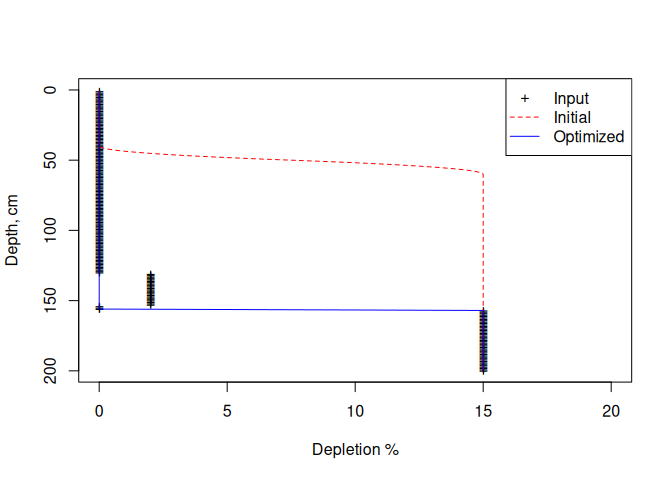
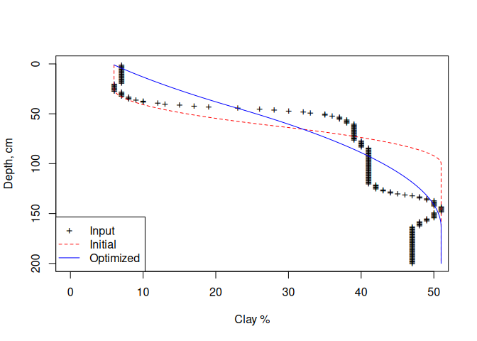

<!-- README.md is generated from README.Rmd. Please edit that file -->

# {soilmotif}

<!-- badges: start -->

<!-- badges: end -->

The goal of {soilmotif} is to provide an easy way to fit generalized
shape functions to soil property data that vary over depth. The
parameters of shape functions are designed to provide simple terminology
and intuitive descriptors for comparing the depth distributions of
properties found in soils of different areas and as predicted by
different types of models.

## Installation

You can install the development version of {soilmotif} like so:

``` r
remotes::install_github("brownag/soilmotif")
```

### Building from Source

{soilmotif} includes a high-performance Rust backend. For detailed
installation instructions, platform-specific troubleshooting, and Rust
compiler setup, see [inst/INSTALL.md](inst/INSTALL.md).

You will need:

- C compiler (included with Rtools, Xcode, or build-essential)

- Rust toolchain (`rustc`, `cargo`):
  <https://www.rust-lang.org/tools/install/>

## Example

This is a basic example which shows you how to fit a sigmoidal depth
distribution model to a step and spline representations of some soil
property data as a function of depth.

The sample data comes from the {aqp} `jacobs2000` dataset. We are using
just select horizon data from the first profile in that
`SoilProfileCollection` object.

``` r
library(soilmotif)

# from aqp::jacobs2000, profile 1
x <- data.frame(
  id = "jacobs2000_1",
  top = c(0, 18, 43, 79, 130, 153, 156),
  bottom = c(18, 43, 79, 130, 153, 156, 200),
  clay = c(7, 6, 39, 41, 51, 50, 47),
  depletion_pct = c(0, 0, 0, 0, 2, 0, 15)
)
```

# Step-wise Horizon-level Depletion Percentage Example

Common morphologic descriptions of soils by genetic horizon can be made
continuous by assuming they represent a “step” function. Repeat the
horizon-level property value as many times as each horizon is thick (in
centimeters, or whatever unit you are interested in).

Here, we convert the percentage of the matrix occupied by depletions
`depletion_pct` into a continuous step-function representation, then
attempt to fit a sigmoid model to the distribution using `sm_motif()`.
After inspection, we use `sm_optim()` to optimize a model based on our
first guess (that the depletions appear around 40 cm and peak by 60 cm).

``` r
depl_step <- rep(x$depletion_pct, x$bottom - x$top)

plot(rep(c(0, 20), 100), 1:200, ylim = c(200, 0), type = "n",
     xlab = "Depletion %", ylab = "Depth, cm")
points(depl_step, 1:200, pch = "+")

# visualize what the "first guess" looks like
lines(sm_motif(depl_step, c(40, 60)), 1:200, col = "red", lty = 2)

# find an optimized model
opt_result <- sm_optim(depl_step, c(40, 60))
lines(opt_result$fitted, 1:200, col = "blue")
opt_result$params
#> [1] 156.6496 156.7814

legend("topright", c("Input", "Initial", "Optimized"),
       pch = c("+", NA, NA),
       lty = c(NA, 2, 1),
       col = c("BLACK","RED","BLUE"))
```



We find that the blue line (the optimized model) captures the
transition, and best-fit parameters indicate a rapid increase at 156 cm
depth, mirroring the increase from the input data.

# Continuous Spline Clay Content Example

The results can be more interesting when the depth function is more
complicated. The simplified shapes can be used to group and generalize
patterns, while ideally capturing the same types of major transitions
across depth.

The following is a mass-preserving spline created using {mpspline2},
with values rounded to integers for compression into `"rle"` object for
minimal example:

``` r
clay_spline <- inverse.rle(structure(list(
  lengths = c(19, 8, 5, 3, 1, 2, 1, 1, 1, 1, 1, 1, 1, 1, 1, 1, 1, 2, 1, 3, 4, 
              17, 7, 37, 5, 2, 2, 1, 1, 1, 2, 2, 6, 6, 6, 3, 5, 38),
  values = c(7, 6, 7, 8, 9, 10, 12, 13, 15, 17, 19, 23, 26, 28, 30, 32, 33, 35,
             36, 37, 38, 39, 40, 41, 42, 43, 44, 45, 46, 47, 48, 49, 50, 51, 50,
             49, 48, 47)), class = "rle"
))

plot(rep(c(0, 50), 100), 1:200, ylim = c(200, 0), type = "n",
     xlab = "Clay %", ylab = "Depth, cm")
points(clay_spline, 1:200, pch = "+")
lines(sm_motif(clay_spline, c(25, 100)), 1:200, col = "red", lty = 2)
opt_result <- sm_optim(clay_spline, c(25, 100))
lines(opt_result$fitted, 1:200, col = "blue")
# Display optimized parameters (note: parameters can fall outside typical [0,1] range)
cat("Optimized Parameters:", opt_result$params, "\n")
#> Optimized Parameters: -23.47231 140.3907

legend("bottomleft", c("Input", "Initial", "Optimized"),
       pch = c("+", NA, NA),
       lty = c(NA, 2, 1),
       col = c("BLACK","RED","BLUE"))
```



In this case we find that the optimized parameters result in a steeper
gradient of property increase than was initially guessed with parameters
`c(25, 100)`. The optimized curve fits the data more closely with a
smoother transition zone centered around 45 cm. Note that the optimized
parameters can fall outside the typical \[0,1\] range for shape
parameters—this is expected behavior as the optimization algorithm
selects parameter values that best fit the observed data, even if they
represent extreme sigmoid transformations.

## Uncertainty Quantification via Bootstrap

{soilmotif} provides bootstrap methods to estimate confidence intervals
for fitted parameters. The framework automatically selects the optimal
resampling method based on data characteristics:

- **Parametric Bootstrap**: For sparse data (n \<= threshold), residuals
  are resampled from a normal distribution
- **Sieve Bootstrap**: For dense data (n \> threshold), residuals follow
  an AR(1) process and are non-parametrically resampled

### Usage

``` r
library(soilmotif)

# Automatic method selection based on data size
result <- sm_optim_bootstrap(
  observed = clay_spline,
  initial_params = c(25, 100),
  depths = 1:200,
  shape_family = "sigmoid",
  n_bootstrap = 1000,
  method = "auto"
)
#> Warning: Bootstrap parameter samples appear corrupted or degenerate: parameters
#> 1, 2 have identical values across all 1000 successful bootstrap replicates.
#> This suggests either Rust FFI returned corrupt data or all optimizations
#> converged to the same point. Check AR(1) coefficients and residual structure.

# View results with confidence intervals
print(result)
#> Bootstrap Results
#> ================
#> Bootstrap method: sieve
#> Shape family: sigmoid
#> Bootstrap samples: 1000
#> Successful fits: 1000 (100.0%)
#> Failed fits: 0
#> AR(1) coefficient (φ): 0.9889
#> AR(1) innovation variance (σ²): 5.1494
#> 
#> Parameter Estimates (95% CI):
#>   Param 1: -84666.818 (-84666.818, -84666.818)
#>   Param 2: 124891.424 (124891.424, 124891.424)
#> 
#> Diagnostics:
#>   RMSE: 1662.980 +/- 0.000
#>   R^2: -3.428 +/- 0.000
#>   AIC: 3538.122 +/- 0.000
#> 
#> Message: Sieve bootstrap completed: 1000 successful, 0 failed (AR1 phi = 0.9889, sigma2 = 5.149359)
summary(result)
#> Bootstrap Summary
#> =================
#> Bootstrap method: sieve
#> Shape family: sigmoid
#> Bootstrap samples: 1000
#> Successful fits: 1000 (100.0%)
#> Failed fits: 0
#> AR(1) coefficient (φ): 0.9889
#> AR(1) innovation variance (σ²): 5.1494
#> 
#> Parameter Statistics:
#>  Parameter      Mean SD  CI_Lower  CI_Upper       Min       Max
#>    Param_1 -84666.82  0 -84666.82 -84666.82 -84666.82 -84666.82
#>    Param_2 124891.42  0 124891.42 124891.42 124891.42 124891.42
#> 
#> Diagnostic Statistics:
#>  Metric        Mean SD         Min         Max
#>    RMSE 1662.980110  0 1662.980110 1662.980110
#>     R^2   -3.428466  0   -3.428466   -3.428466
#>     AIC 3538.122021  0 3538.122021 3538.122021
#> 
#> Message: Sieve bootstrap completed: 1000 successful, 0 failed (AR1 phi = 0.9889, sigma2 = 5.149359)

# Access specific intervals (stored in $summary sublist)
result$summary$param_ci_lower   # Lower bounds (95% CI)
#> [1] -84666.82 124891.42
result$summary$param_ci_upper   # Upper bounds (95% CI)
#> [1] -84666.82 124891.42
result$method_used              # Which method was applied
#> NULL
result$ar1_coef                 # AR(1) coefficient (sieve only)
#> [1] 0.9888556

# Explicit method selection
result_sieve <- sm_optim_bootstrap(
  observed = clay_spline,
  depths = 1:200,
  initial_params = c(25, 100),
  shape_family = "sigmoid",
  n_bootstrap = 1000,
  method = "sieve"
)
#> Warning: Bootstrap parameter samples appear corrupted or degenerate: parameters
#> 1, 2 have identical values across all 1000 successful bootstrap replicates.
#> This suggests either Rust FFI returned corrupt data or all optimizations
#> converged to the same point. Check AR(1) coefficients and residual structure.

result_param <- sm_optim_bootstrap(
  observed = clay_spline,
  depths = 1:200,
  initial_params = c(25, 100),
  shape_family = "sigmoid",
  n_bootstrap = 1000,
  method = "parametric"
)
```

### AR(1) Modeling for Dense Data

When the sieve bootstrap is applied, residuals are modeled using an
AR(1) process:

**r_t = phi \* r\_(t-1) + epsilon_t**

The AR(1) coefficient is estimated using Yule-Walker equations and
exposed in the results. This approach is more appropriate for spatially
correlated residuals commonly found in soil profiles.

## Rust Backend (High-Performance)

{soilmotif} includes an optional high-performance Rust backend for
single-profile and batch optimization. When available, Rust
implementations are typically **10-30x faster** than pure R.

### Usage

``` r
library(soilmotif)

# Check if Rust backend is available
sm_rust_backend_available()
#> [1] TRUE

# Single profile optimization with Rust
profile <- c(rep(10, 50), seq(10, 40, length.out = 100), rep(40, 50))
result <- sm_optim(profile, c(100, 20), use_rust = TRUE)

# Batch processing (ideal for raster grid cells)
profiles <- list(
  c(rep(10, 50), seq(10, 40, length.out = 100), rep(40, 50)),
  c(rep(15, 50), seq(15, 45, length.out = 100), rep(45, 50))
)
batch_result <- sm_batch_optimize_profiles(profiles)
batch_result
#> 
#> === Batch Optimization Result ===
#> Batch result: 2 profiles, 2 successful, 0 failed, method: Sequential 
#> Method: Sequential 
#> 
#> All profiles converged successfully.
```
